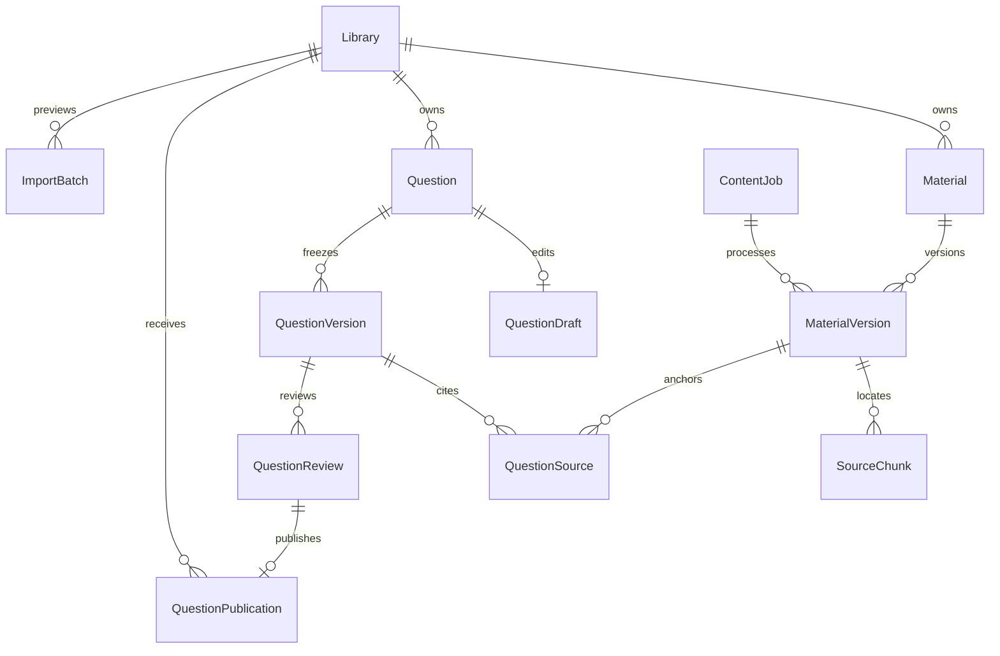

# C-01 v1.1：内容模型、权限与接口提案

状态：A 主已于 2026-10-24 接收的设计提案；接收记录见 `others/docs/a2-start.md`。本文不发布 HTTP、数据库迁移、SDK 或业务能力，C-02 仍须另行审定工作包并由用户手动首次启动。

责任 C；基线 `d18f2faed96effe09c89e29afbe9b803d41a9e75`；当前真实契约 `0.3.2`，迁移头 `b1c0e0a00001`。执行设置已核验为 gpt-6.1-sol / Default / medium。

## 1. 依据、事实与接续步骤

权威输入均为仓库根相对路径：`AGENTS.md`、`others/docs/coordination.md`、`others/docs/ai/C-content-ai.md`、`others/contracts/{README,domain-model,api-conventions,a2-protocols}.md`、`others/contracts/ownership.json`、`others/docs/assistant-floating-handoff.md`。授权细节以 `others/backend/app/domains/core/handoff/b1-content-access.md` 及 `policy.py`、`resource_query.py`、`commands.py` 实际实现为准。配置、ASR、关卡分别复用 `app/core/providers.py`、`app/core/asr_client.py`、`web/src/lib/lesson-protocol.ts`，不重新实现公共原语。

| 项目 | 基线事实 | 后续责任/门禁 |
| --- | --- | --- |
| 学校、学院、目录、教学班、身份及授权 SQL | B1 已实现 | C 只引用，不能新增组织体系 |
| 配置加密、私有 ASR、共享环境 | A 已提供 | C 后续配置业务、任务与助手；不安装新 ASR |
| Material、Question、Lesson、领域 Job | 尚未实现 | C 领域实现；A 注册、迁移、挂载 |
| 内容/助手 HTTP 与 SDK | 尚未发布 | 真实实现及检查后由 A 导出 |
| 学生辅导 gate | B2 返回 unavailable | 学生辅导暂停；普通有权资料不受此暂停影响 |
| 既有 UI / 悬浮助手规范 | 已验收/已冻结设计 | D 唯一入口和助手宿主，C 交内容适配 |
| 正式学习、解锁、考试评分与历史成绩 | 留 B2 | C 交固定内容及内部评分数据，不自行判分 |

接续：A 审定本文 → C-02 资料领域及解析 → A 集成真实模型/迁移/路由 → C-03 题库审核导入及内部版本服务 → 后续短课/检索/配置/建题/历史/语音分包。新增关键界面在所属包先确认方案。完整监控另行放行。C-01 不启动这些包。

## 2. 数据结构与关系

以下名称为提案；字段采用 PostgreSQL UUID、timestamptz、text、boolean、integer/bigint、JSONB。除注明可空项，其余非空。所有时间由服务端生成 UTC；ID 默认服务端 UUID；revision 默认 1、递增；created_at 默认当前时间。没有隐含的默认发布或云处理授权。

图只展示主要关系。资料、题目和后续短课的审核/发布分别使用真实版本外键，不能用没有外键的 kind+id 授予访问。Job 与版本的处理关联可空，不表示每份资料必须由任务创建。

### 2.1 字段与可变性

| 结构 | 字段、类型、可空性和默认值 | 所属及可变性 |
| --- | --- | --- |
| Library，独立表 | id；scope enum；school_id/college_id/catalog_id/course_id UUID 可空；audience enum 默认 staff；title text；creator_id UUID；revision；active bool 默认 true；created_at | scope、组织归属创建后固定；名称/启停按 revision 改；扩大共享另建发布绑定 |
| Material，独立表 | id；library_id UUID；creator_id；title text；revision；retired bool 默认 false；created_at | 稳定资料身份；标题/停用可修订，不以主记录保存笼统 published |
| MaterialVersion，独立表 | id；material_id UUID；version_no int；input_kind=file/text；file_key、original_name、mime text 可空；file_bytes bigint 可空；content_hash text；parser_version text 可空；extraction_state enum 默认 queued；source_metadata JSONB；allow_cloud bool 默认 false；created_by UUID；created_at；job_id UUID 可空 | file 模式须完整文件元数据；text 模式不得冒充上传文件；原始字节/文本和成功提取快照固定。处理中只允许一次提交成功结果；失败任务重试不覆盖成功版本 |
| SourceChunk，独立表 | id；material_version_id UUID；ordinal int；locator JSONB；text text；text_hash text | 唯一(version_id, ordinal)；成功提取后只读。locator 为 PDF page、PPTX slide（对外 page）、DOCX/TXT 稳定 paragraph，不虚构 Word 页码 |
| Question，独立表 | id；library_id UUID；creator_id；retired bool 默认 false；revision；created_at | 稳定题目身份；归属不直接改；停用不删除历史 |
| QuestionDraft，独立表 | question_id UUID 主键；revision；payload JSONB；updated_by UUID；updated_at | 四题型的有类型业务结构；按 revision 编辑；不与发布版本共用可变 JSON |
| QuestionVersion，独立表 | id；question_id UUID；version_no int；draft_revision int；payload JSONB；payload_hash text；created_by UUID；created_at | 提审/冻结时产生，不可覆盖；payload 包含稳定选项 ID、答案、解析、知识点和难度；学生 DTO 不直接序列化它 |
| QuestionSource，独立表 | question_version_id UUID；material_version_id UUID；chunk_id UUID 可空；locator JSONB | 对原始资料/定位建立真实 FK；允许一题多来源；校验 chunk 确属该 MaterialVersion |
| QuestionReview，独立表 | id；version_id UUID；target_library_id UUID；state=submitted/approved/rejected；submitter_id UUID；reviewer_id UUID 可空；submitted_at；decided_at 可空；reason text 可空；revision | 绑定精确版本和目标；决定后只读，重新审核新建记录；作者可以在既有权限下审核，不强制不同人 |
| QuestionPublication，独立表 | id；review_id UUID 唯一；version_id UUID；target_library_id UUID；active bool 默认 true；published_by UUID；published_at；retired_at 可空；revision | 发布必须匹配已批准 review 的版本及目标；只能停用，不更换原版本。资料采用同构 MaterialReview/MaterialPublication，真实 FK 指向 MaterialVersion |
| ImportBatch，独立表 | id；actor_id UUID；work_role enum；target_library_id UUID；input_hash text；normalized_rows JSONB；errors JSONB；state=invalid/ready/committed；revision；created_at；committed_at 可空 | 预检不创建题目；成功确认只生成草稿；确认前目标授权、payload/hash及冲突再验；原文件受控暂存并按任务策略清理 |
| ContentJob，C 领域表 | id；owner_id UUID；work_role；school_id UUID 可空；library_id UUID；kind enum；state=queued/running/succeeded/failed/canceled；input_refs JSONB；progress int 默认0；error_code text 可空；result_ref JSONB 可空；generation int 默认1；created_at；started_at/finished_at 可空 | 本阶段仅资料提取、导入导出所需任务；结果引用受控对象，不是任意文件路径。默认单重任务；调度启动接入交 A，不造全平台任务框架 |

所有 library_id、material_id、question_id、版本/审批/chunk 引用均为对应表的真实外键；creator_id、created_by、actor_id、owner_id、submitter_id、reviewer_id 指向 User。提交/审批账号停用不删除历史引用，外键采用 RESTRICT；组织父级采用下节的同校复合关系。Job input_refs/result_ref 是经过类型校验的值对象，并在执行/读取时重新加载真实资源验证，不能凭 JSON 内 ID 授权。

### 2.2 值对象与后续模型

- source_metadata 是有结构校验的 JSON：origin=upload/open_seed/derived、原 URL/作者/许可/许可 URL/获取日期/原文版本或哈希/翻译改编标记。缺失信息显式 null；缺少许可不推定可公开。复制来源链使用 source_question_version_id 可空 FK 加 source_metadata，不另造通用谱系平台。
- payload 是带题型判别的值对象：single/multiple/true_false/scenario、stem、稳定 options[{id,label}]、answer_ids、explanation、knowledge_points、difficulty。选项唯一、答案存在且数量匹配题型，scenario 仍为情境选择；不在此引入主观评分。
- ContentRef 对外 version_id **唯一指向 MaterialVersion.id**。page/paragraph 由固定 SourceChunk 定位投影。重解析成功旧资料必须创建新 MaterialVersion，即使字节哈希相同。文件 blob 可按哈希复用，但版本/页段不能复用可变结果。
- MaterialVersion 另有 input_text text 可空：text 模式非空且文件字段全空，file 模式为空。知识点输入保存不可变原文、哈希和稳定段落；同样形成 MaterialVersion/SourceChunk，不以文件字段承载文本。
- Lesson/LessonVersion 后续沿用 labconnect.lesson/1，稳定活动 ID、SVG 及评分信息分离；本包只规定版本/发布绑定同一规则，不设计 C-04 之后所有 HTTP。
- 学校配置、Conversation/Message、助手宿主的详细模型在对应包提出，不在本包建表。任务后续配置引用须同时保留学校选择和实际供应商版本。

### 2.3 外键、唯一约束与索引提案

1. Library scope CHECK：platform_public 所有组织字段 NULL；school 只有 school；college 为 school+college；catalog 为 school+目录真实 college+catalog、course NULL；course 使用 Course 的 school/college/catalog/course 完整字段。audience 只可 all/staff。
2. 私有父级使用同校复合 FK。course 范围必须对应 Course 的真实字段；**不要求 Course.college_id = CourseCatalog.college_id**。跨学院开班保持 B1 行为，目录归属从目录读，班级归属从班级读。
3. A 若需为 B1 父表增加可供复合 FK 引用的 UNIQUE，只补必要候选键，不重写 ID 或回填同名合并；检查历史数据后创建约束。
4. UNIQUE(material_id,version_no)、UNIQUE(question_id,version_no)、UNIQUE(question_id,draft_revision)；SourceChunk UNIQUE(version,ordinal)；Publication UNIQUE(review_id)。审核版本、目标库与发布绑定需复合约束或同事务锁校验，不能只信请求字段。
5. 已引用的版本、来源、审批禁止级联删除。库/主记录停用；原文件只有确认无任何保留版本引用后才能清理，历史保留不授予在线读取权限。
6. 索引：Library(scope,school_id,college_id,catalog_id,course_id)；主对象(library_id,id)；版本(parent_id,version_no)；Publication(target_library_id,active,version_id)；SourceChunk(material_version_id,ordinal)；Review(target_library_id,state,submitted_at,id)；Job(owner_id,work_role,state,created_at,id)；ImportBatch(actor_id,target_library_id,input_hash)。查询稳定附加 id；中文关键词用参数化匹配，扩展索引按实测交 A，不新增搜索服务。

QuestionSource 使用独立 id UUID 主键；对(question_version_id,material_version_id,chunk_id)建查询索引，按规范化定位去重。Library 的 audience 与归属同样固定；staff→all 的扩大开放走新目标及逐版本审核，不通过改库字段批量放开。引用页段只有成功提取快照可返回，未成功提取的文件不伪造正文命中或来源定位。

## 3. 状态、发布与共享

| 动作 | 前置 | 结果及并发约束 |
| --- | --- | --- |
| 创建草稿 | 对有权既有库有 S | 新建本人 Question/Draft；不能凭 S 创建或管理整个库 |
| 读取草稿 | B 对当前真实草稿的 R | 仅返回当前可读草稿；staff 或 S 本身不授予他人草稿读取权 |
| 编辑/删除草稿 | 当前资源 R，且（当前范围 S + 有权创建者，或该范围 V）；revision 匹配 | 编辑 revision+1；仅删除可编辑草稿，保留冻结/已引用版本；过期409 |
| 提审 | 当前草稿 R，且（当前范围 S + 有权创建者，或该范围 V）；校验题型、答案、来源及目标 submit | 冻结 QuestionVersion；新建 submitted Review；幂等重复不增版本 |
| 审核 | 当前目标 review 权、同一 submitted revision | approved/rejected，记录审核人/时间/理由；改内容必须新草稿重新提审 |
| 发布 | approved 的确切版本/目标、当前 review 权 | 创建 Publication；再次校验来源/正文/附件/引用可公开性；不靠隐藏 URL 来公开私有内容 |
| 停用 | 目标 review 权、revision 匹配 | binding.active=false；阻止新任务选用；旧试卷快照不漂移；访问仍实时判权 |
| 教职读取已发布版本 | staff 且当前固定版本 R，不要求源库 S | 返回有权教职固定版本；不授予源库管理/编辑权，学生仍无原始答案 |
| 引用 | 源固定已发布版本 R + 目标 S + 来源许可允许，不要求源库 S | 指定版本提交目标题库审核；不追随最新版本，不把来源文件自动共享或修改源库 |
| 复制 | 源固定已发布版本 R + 目标 S + 来源许可允许，不要求源库 S | 新 Question+Draft；版本/许可来源链保留，不继承审批、公开范围或源文件访问，不修改源库 |
| 资料重解析 | 当前资料权限和新任务 | 新 MaterialVersion，旧 ContentRef 永远锚定原版本 |
| Job 开始 | queued、当前权限有效 | running；锁/条件更新确保单重任务 |
| Job 完成 | running、generation匹配、权限及对象仍有效 | succeeded/failed；原子写结果；超时为 failed + TIMEOUT |
| Job 取消 | 本人或范围内获准管理者、非终态 | queued/running→canceled，generation递增；晚到结果不得复活成功；终态重复取消返回当前状态 |

ResourceColumns.published 从“当前版本在目标题库的 active Publication 且匹配 approved Review”计算。不能读取 Material/Question 上的布尔值，也不能因 v1 已发布就返回 v2 草稿。资料发布和题库发布是不同授权事实。

共享仅使用现有五种范围；扩大范围必须重新审核明确版本，校验原文、附件、引用及来源许可。平台公共库不得承载学校私库未经授权的正文；不增加学校间直接共享或全库一键公开。

## 4. 当前身份与五范围权限矩阵

R=read，S=submit，V=review。以下是 B 实现的摘要，不是另一套权限引擎；具体请求仍用 CurrentIdentity、read_resource_predicate 和 resource_access。

矩阵 R/S/V 分别表示资源读取、内容提交、范围审核/管理，不是三个可互相替代的角色。库查询按 R；创建库、改名、启停等整库容器管理必须具有真实目标范围 V 并验证实际父级授权。仅 S 教师可向有权既有库提交本人内容，不能管理整个库；班级任课教师或目录负责人若已具有 B 的 V，仍按该范围管理，不新增角色。

| scope | 平台运维（当前管理员） | 本校学校管理员 | 有范围学院管理员 | 当前教师 | 当前学生 |
| --- | --- | --- | --- | --- | --- |
| platform_public | R/S/V | 已发布 R | 已发布 R | 已发布 R | 仅已发布 audience=all 的安全资料 R |
| school | B 授予的 R/S/V | R/S/V | 本校已发布 R，无学校级 S/V | 本校已发布 R，S；本人草稿 R | 本校已发布 all 资料 R |
| college | B 授予的 R/S/V | R/S/V | 获准学院 R/S/V | 本人学院已发布 R/S；本人草稿 R | 本学院已发布 all 资料 R |
| catalog | B 授予的 R/S/V | R/S/V | 获准目录学院 R/S/V | 负责人 R/S/V；该目录合法授课关系可S、已发布R；无兄弟班私有权 | 目录内合法在班关系且已发布all资料R |
| course | B 授予的 R/S/V | R/S/V | 获准班级学院 R/S/V | 有效任课 R/S/V，不扩到兄弟班 | 有效选课、未归档且已发布all资料R |

- identity.grants 已按当前身份收窄；不能用 all_grants。teacher/admin 兼任按当前身份重新判定；学生账号互斥继续由 B 保障。
- 题库版本、原始题库导入/导出强制 staff；R 不是“学生可读答案”。学生读取普通发布课件不依赖 B2 gate。正式学生短课由 B2 校验任务/解锁后消费安全 DTO。
- B 允许目录负责人和本班任课教师按现有权限审核，不新增作者审核人分离门槛。
- 草稿创建用 S，读取用 B 当前资源 R；修改/删除要求当前 R 且（当前范围 S + 有权创建者，或该范围 V）。不能凭 S 读取、修改他人不可读草稿。已发布固定题目版本的教职读取只需 staff 且 R，不要求源库 S；源 R + 目标 S + 来源许可允许引用/复制，不能修改源库。
- 创建者由当前持久 Question.creator_id 与 identity.user.id 比对，不信任请求中的 creator_id；管理员/教师身份名称本身不替代当前范围的 R/S/V。
- scope/父级/published 等均由服务器真实对象构造，不把客户端 ResourceDescriptor 当凭据。新建时允许请求目标题库 ID，组织归属从真实库及父级加载。
- 搜索：以真实版本/发布绑定拼 ResourceColumns，先授权，再按版本去重、计数、分页、片段/建议。详情、下载、审核、任务结果再次 resource_access，并检查版本/来源/文件不变量。
- 退出一个班仍在同目录另一合法班时可保留目录共享权，不能保留退出班私有权；归档、撤权、停用在旧会话下同样生效。

## 5. 候选操作与 DTO（全部为提案）

正式 URI/operationId 由 A 随真实实现统一，当前不加入 OpenAPI。请求中的范围/学校/用户、purpose、published 不授予权限。

| 候选操作 | 请求字段 | 返回白名单 | 权限 / 幂等 / revision / 错误 |
| --- | --- | --- | --- |
| 库查询 | query,scope,parent_id | id,title,scope,有权父级,能力,revision | 按 R；scope/父级由真实对象校验，不因查询可读而授予管理权 |
| 创建库 | scope,parent_id,title,audience | id,title,scope,真实父级,能力,revision | 真实目标范围 V + 实际父级授权，不能仅 S；服务端推导父级；写幂等；422组合错误 |
| 库改名/启停 | library_id,title/active,revision | id,title,active,revision | 当前目标范围 V + 实际父级授权，不能仅 S；写幂等；归属不可改；409修订冲突 |
| 文件上传/知识点输入 | library_id；file或knowledge_text；来源/许可/allow_cloud | material_id,version_id,input_kind,extraction_state,job_id | S；幂等键及输入hash；格式/大小422，无权限拒绝；allow_cloud仍须学校政策允许 |
| 资料版本/页段查询 | material_id,version_id,定位/分页 | id,version,title,类型,状态,有权文本/定位 | R且具体版本授权；无权对象不返回私有标题；未提取只给真实状态，不造正文 |
| 预览/下载 | material_id,version_id | 安全内容流/文件名与类型，或授权的短期受控地址 | 二次R；不得任意路径/任意URL；撤权/版本不可用拒绝，失败不回退别版本 |
| 草稿创建 | library_id,payload,source_refs | question_id,本人草稿题干/选项/答案解析/来源,revision | staff 且既有目标库 S；写幂等，不授予库管理权 |
| 草稿读取 | question_id | 当前可读草稿题型/题干/选项/答案解析/来源,revision | staff 且 B 对真实草稿的当前 R；不能仅凭 S 读取他人草稿 |
| 草稿修改/删除 | question_id,payload/source_refs,revision | 修改后的草稿白名单及revision，或最小删除回执 | staff、当前资源 R，且（当前范围 S + 有权创建者，或该范围 V）；写幂等/冲突409；冻结及已引用版本不删除 |
| 教职读取已发布固定版本 | question_id,version_id | 有权固定版本题型/题干/选项/答案解析/来源 | staff 且该已发布固定版本 R，不要求源库 S；不授予源库修改/整库管理权；学生无此接口 |
| 导入预检 | target_library_id,format=csv/xlsx,file | batch_id,input_hash,revision,有效数/重复/逐行错误/预览 | S/staff；校验四题型和来源，零题目写入；不能执行公式/宏；限制交A文件政策 |
| 导入确认 | batch_id,input_hash,revision | batch_id,created_draft_ids,count | 再验身份/目标/内容，事务内原子、幂等；无效422、变化409、撤权拒绝 |
| 导出 | library_id,version_ids,format | job_id；结果经鉴权下载 | staff R，每条再次鉴权；幂等；不允许学校参数扩大范围或导出学生身份答案 |
| 提审/决定/发布/停用 | version_id,target_library_id；review_id/decision/reason；revision | review/publication id,state,version_id,target,revision,时间 | 提审须当前草稿 R 且（当前范围 S + 有权创建者，或该范围 V），并具目标 S；V审核发布停用；写幂等；载荷不同同键/状态或revision变化409；来源不可公开拒绝 |
| 引用/复制 | source_version_id,target_library_id,revision | 新review或新question/draft id、来源链 | 源固定已发布版本 R + 目标 S + 来源许可，不要求源库 S；幂等；复制不继承发布，不修改源库；不得将私有来源仅改标签后公开 |
| 资料/教职题库搜索 | q,scope/library/course/type/knowledge/updated筛选,page,page_size,sort | authorized_total,items安全投影,片段,定位,稳定游标/分页 | 先R再count/page；staff题库；参数长度/分页上限/排序白名单由A接入锁定；422无效参数 |
| Job读取/取消/结果 | job_id；取消请求代次 | id,state,progress,error_code,经授权结果引用 | 创建者当前身份/范围或获准管理者；结果再验；取消幂等；不返回原始供应商错误/文件路径 |

公共错误：401真实用户会话无效；403已知操作无权限；不可读跨范围对象可统一404避免存在性泄露；409幂等载荷/修订/状态冲突；422请求内容非法；503依赖不可用。领域任务模型错误/超时在 failed/error_code 表达，不伪装用户401。正式错误码清单由 A 随接口审定。

所有创建、提审、审核、发布、复制、导入确认等写入使用 Idempotency-Key，编辑/状态变更同时携带 revision 或 If-Match。键按操作者、当前工作身份与操作隔离，同键不同规范化载荷409；相同载荷只重放经当前权限重新投影的最小结果。

### DTO 与内部服务边界

| 消费方 | 允许字段 | 必须排除 |
| --- | --- | --- |
| 学生资料/搜索 | 已发布有权版本ID、题名、正文/片段、固定页段、类型 | 草稿、教师题库答案、内部文件键、隐私来源名、未公布解析 |
| StudentLesson | 现有 lesson-protocol 学生字段，稳定活动/选项、场景和来源 | correct_ids、answer_ids、评分配置、含答案标记/顺序/隐藏HTML |
| 教职编辑/预览 | 当前权限内草稿、答案解析、审核信息；TeacherLessonPreview | 其他范围数据、密钥/密文；不可直接序列化持久模型 |
| B2内部版本解析 | 确切版本、内容hash、题干/答案解析/活动评分数据、固定来源与授权结果 | 用户可通过purpose取得的内部评分接口、自动取最新版本 |

B2内部调用必须来自服务端已认证身份和班级授权，校验版本已审核发布、目标可用及未停用；发布试卷再固定自己的答案/规则快照。以后历史评分从该试卷快照读，不因新版本或停用而改分。学生业务只能取安全投影，不能调用评分服务。后续AI配置、历史、宿主和语音本包只列依赖，不虚构未来HTTP。

## 6. 命令回执、审计与任务接入

优先复用 B 的 execute_command、CommandReceipt、revision校验、事务和重放鉴权能力；先检查其操作语义适用再调用，不修改B文件。提案写操作回执仅存对象ID/版本ID/状态和最小计数，每次按当前权限重新加载并投影。题干答案、导入明文、文件地址、密钥及完整任务结果不存长期回执，以免撤权后重放泄漏。

库管理、审核、发布、复制等可复用现有 CoreAuditEvent 的操作者/工作身份/operation/details；details仅存资源ID、目标、版本及结果。若A认定命名或空school_id不适配，由A提供最小扩展，不由C建立全平台通用审计体系。被拒绝操作的必要审计由A统一，不破坏原子回滚。

ContentJob 只为本领域持久状态和重型单任务调度服务。queued/running/终态更新使用条件与generation，超时failed/TIMEOUT，取消晚到结果作废。进程重启遗留running须明确标记失败后由用户重试，不报已成功；重新排队遵幂等策略。执行前、提交结果前和读取结果时重验身份与资源，不在worker直传业务数据库凭据。A负责启动衔接/公共DTO，C负责领域执行；不引入Redis/Celery或全平台任务框架。

## 7. A、D、B2接收清单

### A公共接入提案

| 接入项 | 前置/完成证据 |
| --- | --- |
| 模型集中注册与迁移 | C提交真实领域模型后，A维护app/models.py及Alembic，由b1c0e0a00001继续；先审现有数据/候选键，补范围CHECK、复合FK、唯一约束和索引，不create_all替代迁移 |
| 文件区及解析依赖 | A明确受控存储、上传/解压/页数/任务配额和清理策略，按业务3.14/worker3.13锁依赖；C仅提供需求，不安装/升级共享环境 |
| 事务回执/审计/Job | A确认B能力复用及最小公共扩展、任务启动/状态DTO/错误，不让回执绕过二次鉴权 |
| 路由和真实契约 | C候选路由实现交A总挂载，版本唯一源、OpenAPI/哈希/SDK一致发布完整SHA；本提案不生成占位客户端 |
| B2/预览公共类型 | 固定版本内部服务与学生/教师DTO；LessonEditorProps.renderPreview注入保持无循环导入 |
| 后续配置及宿主 | providers原语复用；A明确出网/重定向策略及正式宿主Adapter；C后续包细化持久化、问答历史/语音接口 |

A在每包执行工作单中锁定技术配额/名称及责任文件；C不得擅自编辑公共迁移、依赖、SDK、路由或B/D源码。A接收C-01不等于发布这些接口。

### D与B2消费

- D：普通资料/题库/审核/设置页的 PageRegistration、所需角色/参数/错误状态；C自有真实API开发夹具。教师编辑器仅接收renderPreview，C不导入D学生模块。
- D助手：后续只交内容/个人历史/固定范围/引用/音频/任务与停止取消清理回调；D唯一宿主，不新增独立聊天PageRegistration或fixed容器。
- B2：固定版本选择与内部受控答案、StudentLesson投影；正式解锁/作答/评分/培训记录由B2。B2提供真实账号级gate后联合验证。
- 未知B2 gate暂停学生AI及历史/引用，不关闭普通授权课件；后续C教师真实链路可验收，不能把B2联合或A副三端录音设成C交付的循环前置。

## 8. 后续实现验收矩阵

以下都是未来实现测试，本包没有运行或宣布通过。

| 编号 | 场景与必要证据 |
| --- | --- |
| T01 | 跨校伪造库/父级/版本ID，count、列表、详情、直链、下载和任务均不能读私有数据 |
| T02 | 学院越界、当前teacher/admin收窄、撤销身份后旧请求拒绝，不合并all_grants |
| T03 | 同目录双班仅共享已批准绑定；名册/私有课件不互通；退一班仍有另一班时共享保留、退出班私有失效 |
| T04 | 校管理员将班开到目录以外学院仍可用；库采用Course实际college，目录库采用目录college，不误加二者相等约束 |
| T05 | v1已发布、v2草稿；学生搜索/直链/片段/任务不得得到v2；审核旧revision不能批准新内容 |
| T06 | 同文件哈希重新解析新MaterialVersion；旧ContentRef页段和题目/历史引用保持原快照；知识点输入有稳定段落 |
| T07 | 扩大范围校验正文/附件/引用许可，隐藏私有URL不足以通过；公共库不能装入未授权学校正文 |
| T08 | 撤权、退班、停用后，重放回执/计数/片段/下载/后台执行/结果读取再次鉴权，无私有题名泄漏 |
| T09 | CSV/XLSX逐行错误使预检零建题；提交重验失败全回滚；同键同载荷不重复建题、异载荷409；答案选项/稳定ID校验 |
| T10 | 多人编辑revision冲突409；引用固定、复制新草稿不继承审批；停用不更改B2已发布试卷快照 |
| T11 | 学生DTO递归检查无answer_ids/correct_ids/评分/隐含答案；教师预览无Attempt/进度/成绩写入 |
| T12 | 未知考试gate使学生AI不可用而普通资料可读；后续B2真实考试跨班/设备暂停由联合验收补齐 |
| T13 | Job取消与完成竞争，canceled不复活；超时failed；重启中断真实反馈；worker失效不阻塞普通业务 |
| T14 | 文件损坏/扫描/加密/类型冒充/超额明确失败，页段不伪造；源文件和导出结果访问再次鉴权 |
| T15 | 仅有源 R、没有源 S 的教师可读取公共已发布固定题目版本，在来源许可允许且目标 S 时可引用/复制到授权目标；修改源题或管理源库拒绝，学生仍不能读原始题库答案 |
| T16 | 仅 S 教师可在有权既有库创建本人草稿；创建库/改名/启停等整库管理拒绝，读取或修改他人不可读草稿拒绝；具有范围 V 的管理者在当前 R 及真实父级授权下管理库和草稿成功 |

## 9. C-01本包验收与停止条件

本包仅交此提案；检查基线/所有权/依赖输入、准备与文档引用、diff空白、唯一正式文件范围，并在忽略reports/c-01保存命令及覆盖证据。不得把后续T01–T16或既有A/B测试算作本包业务通过。

设置、基线、权限、跨模块或新业务取舍冲突交A；普通局部失败最多修复复查三轮。每轮修改本地提交，C不推送。交A完整SHA、文件路径、检查结果和技术接收项；按handoff生成临时脱敏摘要。A接收后另行批准C-02，本包不自动继续整包Goal。
